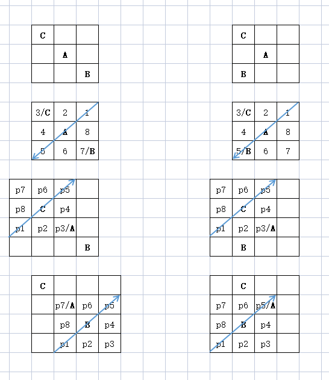

# flood-analysis

淹没分析是一个复杂的过程，受多种条件和多种因素的影响，淹没分析可以分为有源淹没和无源淹没两大类。

## 无源淹没

对于无源淹没，在给定水位的情况下，凡是区域内给定水位以下的地区均记入淹没区，相对来说比较简单。

## 有源淹没

有源淹没主要是洪水淹没，其分析需考虑连通情况，即洪水只能淹没它能流到的地方，比如环形山，如果水位低于环形山的高度，虽然其内部高程比水位地，也不会被淹没。洪水特性和受淹区的地形地质地貌条件是影响洪水淹没的主要因素。

对于一个特定防洪区域而言，洪水淹没可能有两种形式，一种是漫堤式淹没，即堤防并没有崩溃，而是由于河流中洪水水位过高，超过堤防的高程，洪水漫过堤顶进入淹没区；另一种是决堤式淹没，即堤防溃决，洪水从堤防决口处流入淹没区。无论是漫堤式淹没还是决堤式淹没，洪水的淹没都是一个动态的变化过程。（另外，要进行淹没过程的模拟，还要考虑到水流方向，即自然地表水流总是由高处向低处流动，而且是沿着最陡的方向流动。）

## dem_processor

有源淹没分析，采用八邻域种子填充算法。


将淹没范围（边界点）以 GeoJSON 格式写入文件时，采用坐标分析算法将离散点顺时针或逆时针排序。



### 使用

```PowerShell
# python dem_processor.py source_file

PS E:\Workspace\Codes> python.exe .\dem_processor.py .\dem_test.tif
```
